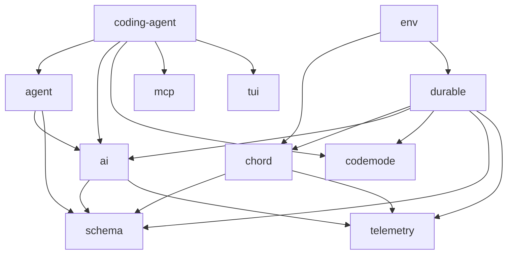

# 实践课2：组织建仓与源码分析 LiYunyi

## 1. 源码获取

- 小组组织：`open-source-slackers`
- 小组代码仓库：https://github.com/open-source-slackers/pi-hunnu-2026
- 本人实际 clone 地址：https://github.com/open-source-slackers/pi-hunnu-2026.git
- 本地路径：D:\PiAgent-fork\pi-hunnu-2026
- 当前分支：main
- 完整提交编号：c3cc91632d0a1950fb122605b190233f2aa0006e
- `git status --short`：无输出（工作区干净）

**截图展示：**

小组组织仓库截图：

S1：clone 后终端信息截图：

源码目录截图：

## 2. 子模块分析表
> 注：`evals` 不属于本次作业给出的原始模块列表，为代码库实际多出的模块，无构建脚本，不参与主体构建流程。

| 子文件夹 | 代码主要实现什么功能 | 本模块 build 执行什么、生成什么 | 直接依赖哪些内部模块 | 依据文件或代码位置 |
|---|---|---|---|---|
| `telemetry` | 遥测、日志或指标收集功能 | `tsc -p tsconfig.build.json`，编译 TS 并生成产物 | 无 | `telemetry/package.json` |
| `schema` | 数据结构定义、类型校验 | `tsc -p tsconfig.build.json`，编译 TS 并生成产物 | 无 | `schema/package.json` |
| `chord` | 涉及通信、协同机制 | `tsc -p tsconfig.build.json`，编译 TS 并生成产物 | `schema`, `telemetry` | `chord/package.json` |
| `tui` | 终端用户界面组件库 | `tsc -p tsconfig.build.json`，编译 TS 并生成产物 | 无 | `tui/package.json` |
| `codemode` | 代码执行/沙盒模式（依赖 quickjs） | `tsc -p tsconfig.build.json`，编译 TS 并生成产物 | 无 | `codemode/package.json` |
| `mcp` | Model Context Protocol 模型上下文协议支持 | `tsc -p tsconfig.build.json`，编译 TS 并生成产物 | 无 | `mcp/package.json` |
| `ai` | 封装各大模型（OpenAI, Anthropic 等）的接口 | 先执行 `generate-models`，再执行 `build:offline`，完成类型与代码编译 | `schema`, `telemetry` | `ai/package.json` |
| `durable` | 持久化、工作流或状态保存 | `tsc -p tsconfig.build.json`，编译 TS 并生成产物 | `chord`, `ai`, `codemode`, `schema`, `telemetry` | `durable/package.json` |
| `env` | 环境隔离或运行时环境管理 | `tsc -p tsconfig.build.json`，编译 TS 并生成产物 | `chord`, `durable` | `env/package.json` |
| `agent` | AI Agent 核心循环与状态管理 | `tsc -p tsconfig.build.json`，编译 TS 并生成产物 | `ai`, `schema` | `agent/package.json` |
| `coding-agent` | 终端 AI 编程助手 CLI | 先执行 `build:unbundled` 编译，再执行脚本 `build-coding-agent-bundle.mjs` 打包产物 | `agent`, `ai`, `codemode`, `mcp`, `tui` | `coding-agent/package.json` |
| `evals` | 评估、测试用例模块，仓库额外模块 | 无 build 脚本，不参与主体构建 | 无 | 仓库 packages/evals 目录，无构建配置 |
## 3. 模块依赖关系图

> 说明：考虑到部分 Markdown 渲染环境偶尔会出现 Mermaid 代码块加载失败的情况，此处直接提供图片以便直观查看。下方同时保留了可编辑的 Mermaid 图源。

**可编辑图源（Mermaid）：**

**层级划分依据：**
本图严格根据各子模块 `package.json` 中的 `dependencies` 字段提取直接依赖，箭头方向统一为“使用方 → 被依赖方”。代码内内部包使用 `@earendil-works/*` scope 别名，报告中为简化表述直接使用文件夹名称指代模块。
`schema` 和 `telemetry` 处于最底层，不依赖内部模块；`ai`、`chord` 等属于中间能力层；`agent` 属于编排层；`coding-agent` 和 `env` 处于应用入口层。注：`chord` 模块的 `peerDependencies`（如 react、esbuild）属于外部依赖，故未在内部模块图中体现。

## 4. 结合分析回答问题

**4.1 根目录与子模块中的 npm run build 分别读取什么配置、执行什么工作？**
根目录的 build：读取根目录 `package.json`，脚本为串行执行的 shell 命令，依次进入各个子模块目录并调用子模块的 build 脚本。作用是按预设顺序批量触发所有子包构建。

子模块的 build：读取子模块目录下的 `package.json` 和 `tsconfig.build.json`。大部分模块（如 `agent`）执行 `tsc -p tsconfig.build.json`，编译 TypeScript 源码，产出 JS 文件与类型声明；`coding-agent` 在编译完成后，额外执行 bundle 打包脚本，输出可直接运行的 CLI 产物。

**4.2 构建顺序和模块依赖有什么关系？相邻构建的模块是否一定互相依赖？**
构建顺序由模块依赖关系约束：根目录 build 脚本手动编排串行执行顺序：`telemetry → schema → chord → tui → codemode → mcp → ai → durable → env → agent → coding-agent`，优先编译底层基础模块，再编译依赖它们的上层模块，保证上层模块编译时，依赖模块的编译产物已经就绪。

相邻构建的模块不一定互相依赖。例如 `tui` 和 `codemode` 在构建脚本中相邻执行，但二者没有内部依赖关系，只是同属基础能力模块，被上层应用共同依赖。这种手动编排方式缺点明显：新增模块、修改依赖时，需要人工维护构建顺序，容易出错。

**4.3 选择一条涉及至少三个模块的依赖路径，说明这些模块如何分工。**
选择的依赖路径：`coding-agent → agent → ai → schema`

分工说明：
`schema` 作为最底层基础模块，统一定义全链路的数据结构、接口类型，保证各个模块之间数据交互格式一致；
`ai` 依赖 `schema`，基于统一类型规范封装各大 LLM 厂商的调用接口，对外提供标准化的模型调用能力；
`agent` 依赖 `ai`，在模型能力之上实现智能体核心调度、会话状态管理、任务循环逻辑；
`coding-agent` 是面向用户的 CLI 应用入口，依赖 `agent` 提供的智能体能力，组装终端交互、代码沙箱、MCP 等能力，最终对外提供终端 AI 编程助手服务。
