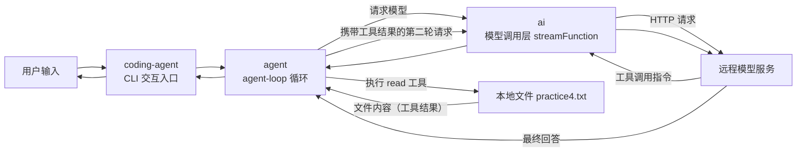

# 实践课4：Pi Agent 模型调用与运行流程报告 LiYunyi

- **姓名拼音：** LiYunyi
- **小组仓库地址：** https://github.com/open-source-slackers/pi-hunnu-2026
- **本地仓库路径：** `D:\PiAgent-fork\pi-hunnu-2026`
- **提交编号：** c3cc91632d0a1950fb122605b190233f2aa0006e
---

## 一、源码修改

本实验在实践课 3 已构建的 Pi 项目中，向 `packages/agent/src/agent-loop.ts` 的 Agent 循环加入两行日志，用于观察 Agent 何时请求模型、工具结果如何进入下一轮对话。

### 1. 在模型调用前打印日志

在 `const response = await streamFunction(...)`（修改前第 412 行）**上方**插入一行日志。每次执行到这里，Agent 都准备把当前上下文交给模型调用函数。

```ts
	// Resolve API key (important for expiring tokens)
	const resolvedApiKey =
		(config.getApiKey ? await config.getApiKey(config.model.provider) : undefined) || config.apiKey;
	console.error("[P4] Agent 即将请求模型"); // 新增
	const response = await streamFunction(config.model, llmContext, {
		...config,
		apiKey: resolvedApiKey,
		identity: mergeClientIdentity(DEFAULT_AGENT_IDENTITY, config.identity),
		signal,
	});
```


**截图 S1：** 显示编辑器中的 `agent-loop.ts` 文件名、行号，以及新增的 `[P4] Agent 即将请求模型` 日志，画面中同时可见日志下方的 `await streamFunction(...)`。

### 2. 在工具结果加入上下文后打印日志

在 `currentContext.messages.push(result)`（修改前第 284 行）**下方**、`for` 循环内部插入一行日志。每写入一条工具结果就打印一次。

```ts
				for (const result of toolResults) {
					currentContext.messages.push(result);
					console.error("[P4] 工具结果已加入上下文"); // 新增
					newMessages.push(result);
				}
```


**截图 S2：** 显示 `agent-loop.ts` 中的 `for` 循环、`currentContext.messages.push(result)` 以及紧接着新增的 `[P4] 工具结果已加入上下文` 日志。

两行日志分别位于 Agent 循环的"模型调用前"和"工具结果写回上下文后"两个关键位置，第一类日志记录 Agent 到达一轮模型调用的位置，第二类日志记录一条工具结果写入上下文。

---

## 二、重新编译并启动

保存源码后，在项目根目录执行构建命令：

```powershell
npm run build
```


**截图 S3：** 显示项目根目录中的 `npm run build` 命令、构建结束返回命令提示符，以及紧接着运行 `$LASTEXITCODE` 得到的 `0`（构建成功）。

构建成功返回后，直接启动编译产物：

```powershell
node .\packages\coding-agent\dist\cli.js
```


**截图 S4：** 显示执行 `node .\packages\coding-agent\dist\cli.js` 的命令和成功打开的 Pi 交互界面。两行 `[P4]` 日志会写到终端，可能与 Pi 的交互界面混在一起。

---

## 三、对比两次运行

在项目根目录创建 `practice4.txt`，写入一行实验代号：

```text
exp-pi-20261124
```

使用同一模型，分别在两个新会话中输入指令，观察是否调用工具以及 `[P4]` 日志出现的顺序。

| 会话 | 输入给 Pi 的指令 | 是否调用工具 | [P4] 日志（按出现顺序） | 模型调用轮数 |
| --- | --- | --- | --- | --- |
| A：直接问答 | 请直接用一句话解释什么是 Git 分支。 | 否 | `Agent 即将请求模型` ×1 | 1 轮 |
| B：读取文件 | 请用 `read` 工具读取当前目录的 `practice4.txt`，并告诉我文件中的实验代号。 | 是（read 工具） | `Agent 即将请求模型` → `工具结果已加入上下文` → `Agent 即将请求模型` | 2 轮 |

### 1. 会话 A：直接问答

- **输入指令：** `请直接用一句话解释什么是 Git 分支。`
- **是否调用工具：** 否。全程没有出现 `[P4] 工具结果已加入上下文` 日志。
- **[P4] 日志顺序：** 仅出现 1 条 `[P4] Agent 即将请求模型`。
- **最终回复：** 模型直接给出对 Git 分支的一句话解释。


**截图 S5：** 显示会话 A 的输入指令、Pi 最终回复和实际出现的 `[P4]` 日志。本次仅进行了 1 轮模型调用，未触发任何工具。

### 2. 会话 B：读取文件

- **输入指令：** `请用 read 工具读取当前目录的 practice4.txt，并告诉我文件中的实验代号。`
- **是否调用工具：** 是。Pi 调用 `read` 工具读取了 `practice4.txt`。
- **[P4] 日志顺序：**

```text
[P4] Agent 即将请求模型
[P4] 工具结果已加入上下文
[P4] Agent 即将请求模型
```

- **最终回复：** Pi 返回文件中的实验代号 `exp-pi-20261124`。


**截图 S6：** 显示会话 B 的输入指令、`read` 工具读取 `practice4.txt` 的记录、Pi 返回的实验代号，以及实际出现的两类 `[P4]` 日志。本次共进行了 2 轮模型调用：第一轮生成工具调用请求，工具执行后，第二轮携带工具结果请求模型并得到最终回答。

---

## 四、运行流程分析

### 1. 谁实际读了文件

**实际读文件的是本地执行的 `read` 工具，而不是远程模型。**

远程模型（LLM）在第一轮请求中只生成"调用 `read` 工具"的指令，它本身并不接触本地文件；真正打开并读取 `practice4.txt` 的动作，由 coding-agent / agent 在本地调用 `read` 工具完成。模型只有在第二轮请求时，通过上下文中的工具结果"间接看到"文件内容。

### 2. 下一轮模型请求多带了什么

第一轮请求的上下文只包含用户消息；工具执行后，Agent 把工具结果消息（即 `read` 工具返回的 `practice4.txt` 内容 `exp-pi-20261124`）写回上下文。因此第二轮模型请求的上下文多带了一条**工具结果消息**，具体包含：

- 原始用户消息；
- 助手生成的工具调用消息；
- 工具返回的结果（读到的文件内容）。

模型正是凭借这条新增的工具结果，回答出文件中的实验代号。

### 3. 组件关系简图



各组件职责：

- **coding-agent**：命令行交互入口，负责接收用户输入、调度工具并输出回复；
- **agent**：Agent 循环（`agent-loop.ts`），编排"请求模型 → 执行工具 → 写回结果"的循环，本实验加入的两行日志即位于此处；
- **ai**：模型调用层，负责把消息转换成 LLM 格式并通过 `streamFunction` 请求模型；
- **远程模型服务**：真正运行大模型、生成回答或工具调用指令的远端 API。

---

## 五、总结

通过两行日志对比两次会话可以看出：直接问答不触发工具，仅进行 1 轮模型调用；读取文件时，第一轮模型调用生成工具请求，本地 `read` 工具真正完成文件读取并把结果写回上下文，随后第二轮模型调用携带工具结果得到最终回答。这验证了 Pi Agent 的"请求模型 — 执行工具 — 写回结果 — 再次请求模型"循环：模型只负责推理与决策，本地工具负责与文件系统交互，两者通过消息上下文衔接。
