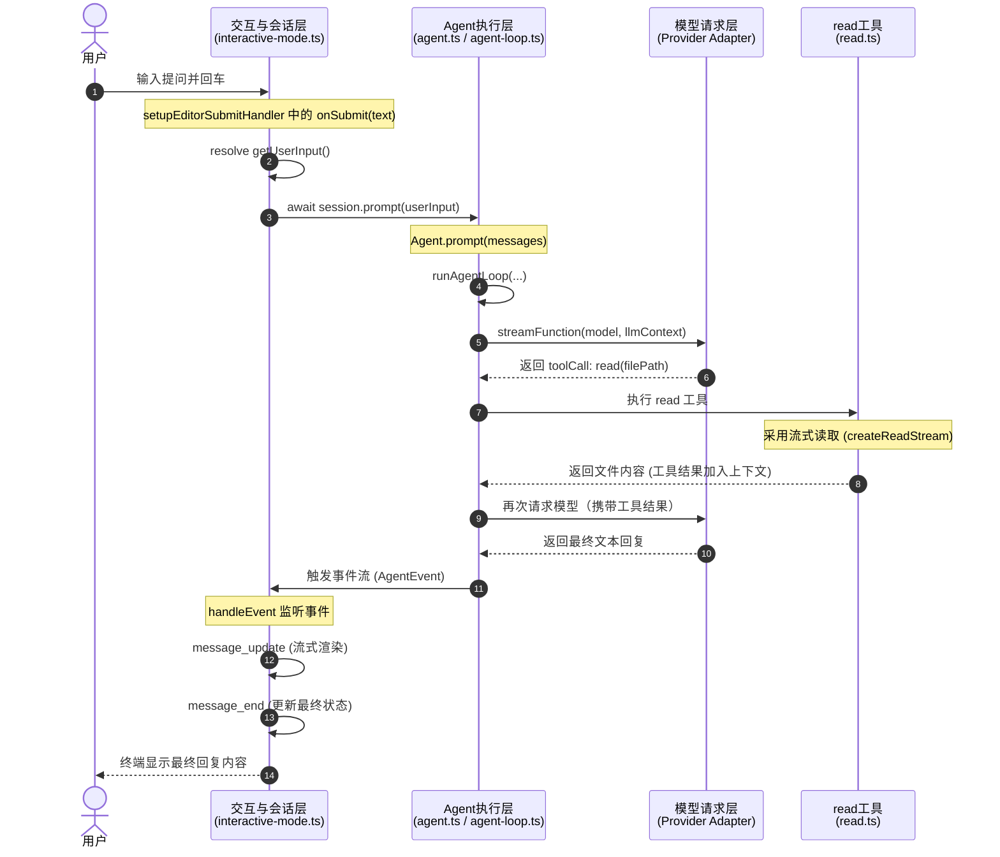
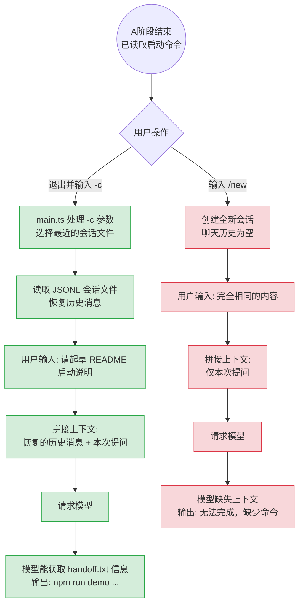

# 实践课5：Pi Agent 源码泛读与功能定位 LiYunyi

**姓名**：李韵怡

**学号**：202430224028

**随机标识**：`7uuu-uuu`

## 一、 实验环境与准备

 **启动方式**：本地构建产物 `node ./packages/coding-agent/dist/cli.js`
 
 **工作目录**：`D:\PiAgent-fork\pi-hunnu-2026`
 
 **准备文件**：`handoff.txt`
  ```text
  待办：补充 README 的启动说明
  启动命令：npm run demo -- --profile 7uuu-uuu
  ```

---

## 二、 实验过程与观察记录

### A. 单轮交互与工具调用

**1. 用户输入**
在 Pi 交互界面中输入：
> 请用 read 工具读取当前目录的 handoff.txt，原样告诉我待办和启动命令。

**2. 观察记录**
- **工具调用**：Agent 成功理解意图，触发 `read` 工具，实际参数为 `D:/PiAgent-fork/pi-hunnu-2026/handoff.txt`。
- **模型调用**：发生了两次模型请求。第一次模型输出了工具调用请求；工具执行完毕后，终端显示 `[P4] 工具结果已加入上下文`，随后 `[P4] Agent 即将请求模型`，模型进行第二次输出，向用户展示了完整原样内容。
- **回复显示**：Agent 成功返回了待办和启动命令。


### B. 恢复上次会话 vs 新建会话

**1. 恢复原会话 (`-c`)**
- **操作**：退出 Pi，在项目目录使用 `node ./packages/coding-agent/dist/cli.js -c` 重新启动，终端成功恢复了 A 阶段的聊天记录。
- **输入**：> 接着上次的待办，给 README 起草一条启动说明，写出交接单里的完整启动命令。只用这次会话已有的信息。不要调用工具。如果缺少命令，请直接说明。
- **观察记录**：
  - **工具调用**：无（严格遵循了“不要调用工具”的指令）。
  - **回答内容**：成功给出了 `npm run demo -- --profile 7uuu-uuu`，并解释该信息来自恢复的会话历史（"From the handoff, the startup command is..."）。


**2. 新建会话 (`/new`)**
- **操作**：在交互界面输入 `/new`，随后输入与 B1 完全相同的提问。
- **观察记录**：
  - **工具调用**：无。
  - **回答内容**：Agent 明确表示无法完成起草，原因是“这次会话里没有交接单或上次待办的内容”，并说明缺少“交接单原文里记录的完整启动命令”。这证明新会话的上下文为空，没有 A 阶段的数据。


---

## 三、 代码级分析图表

### 图 1：单轮工具调用的代码级时序图

以下为 Mermaid 格式的时序图，你可以使用支持 Mermaid 的 Markdown 编辑器（如 Typora、GitHub）直接预览，或将渲染后的图片放入报告中。



**源码定位说明**：
- **输入入口**：`interactive-mode.ts` 的 `onSubmit` 钩子接收文本，并调用 `session.prompt()`。
- **启动循环**：进入 `agent.ts` 的 `Agent.prompt()`，随后在 `agent-loop.ts` 的 `runAgentLoop` 中进行多轮循环。
- **模型边界**：通过 `ModelRuntime.streamSimple` 发起远端请求。
- **read工具**：源码位于 `packages/coding-agent/src/core/tools/read.ts`，底层使用了 `createReadStream` 进行流式读取，而非一次性读取。
- **显示回复**：回到 `interactive-mode.ts` 的 `handleEvent`，通过 `message_update` 和 `message_end` 分支更新 UI 界面。

---

### 图 2：恢复旧会话和新建会话的对照图



**源码定位说明**：
- **恢复旧会话 (`-c`)**：由 `packages/coding-agent/src/main.ts` 解析 `--continue` 参数，定位并读取 `~/.pi/agent/sessions/` 下的 JSONL 文件。恢复时，Pi 将文件中的 entry 转化为历史消息，与新的 User Prompt 组合后发送给大模型。
- **新建会话 (`/new`)**：清空内存中的 `SessionContext`，历史消息栈置为空。此时请求模型的上下文仅包含当前的一轮对话。这就解释了为什么图3中新建会话的 Agent 会要求补充信息。

---

## 四、 实验总结

通过本次实验，我深入理解了 Pi Agent 的运行机制：
1. **工具调用循环**：单次用户提问可能引发多次模型请求。`read` 工具的底层实现通过 `createReadStream` 保证了文件读取效率。
2. **事件驱动的 UI**：模型生成的流式响应通过 `AgentEvent` 触发 `handleEvent`，通过 `message_update` 和 `message_end` 实现了终端界面中光标流动与最终定稿的效果。
3. **会话状态管理**：`-c` 启动与 `/new` 启动在底层加载的上下文完全不同。Pi 依赖本地 JSONL 文件实现了跨进程的会话持久化。这也提示我们在日常使用中，如果想延续上下文，应当妥善利用 `-c` 恢复功能，避免产生“Agent 失忆”的问题。
